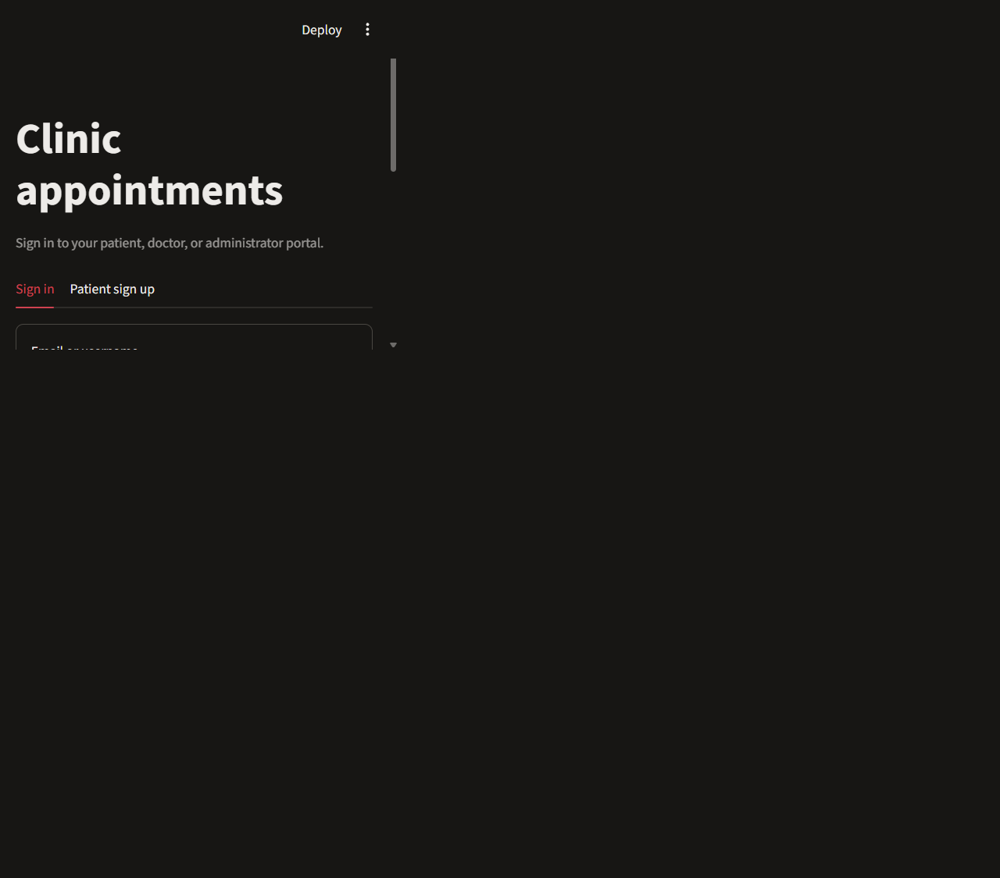
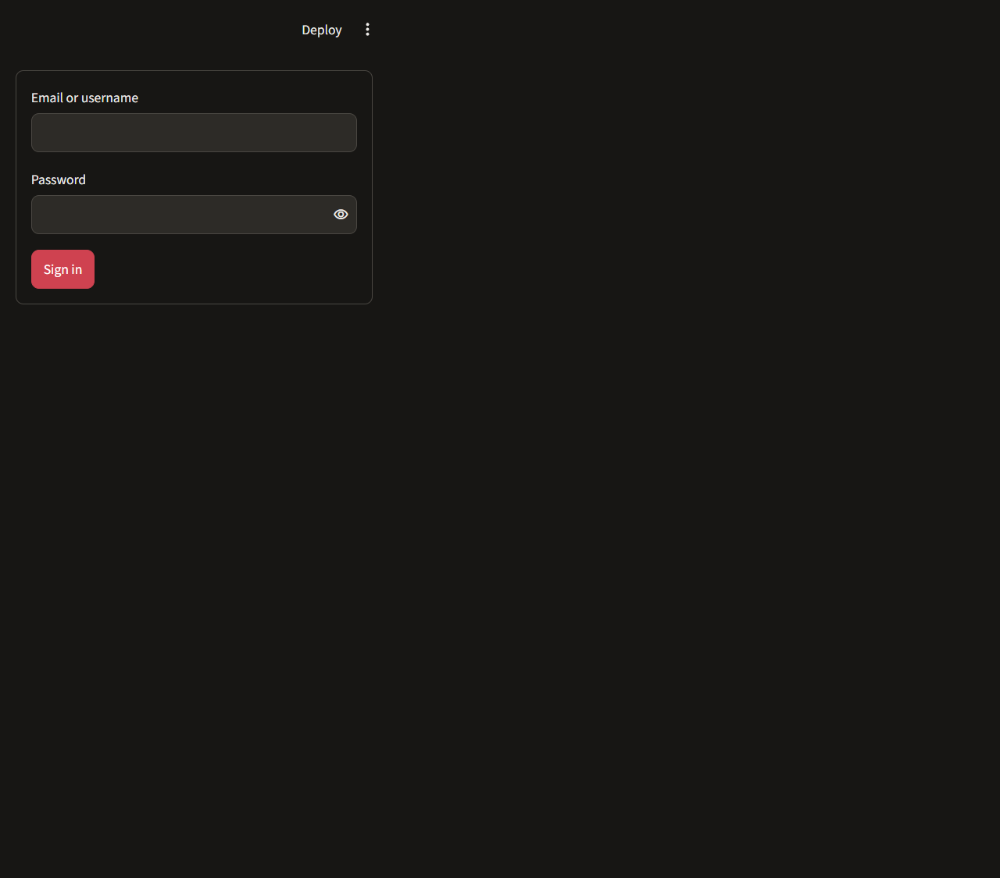
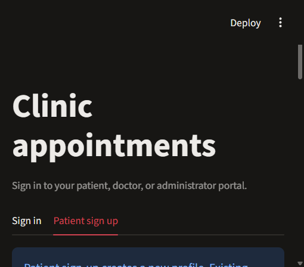
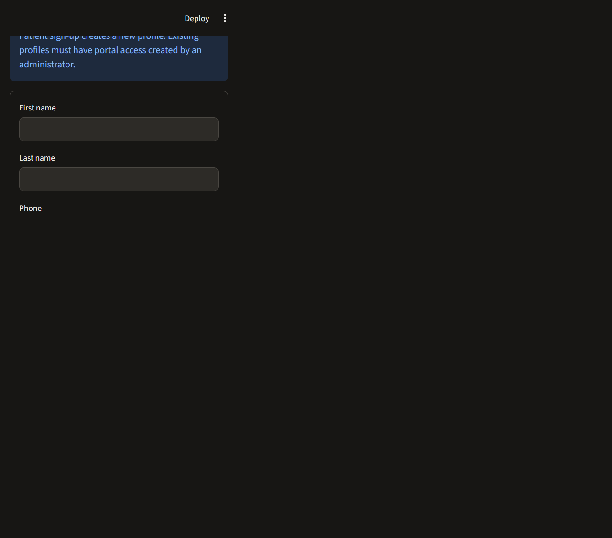
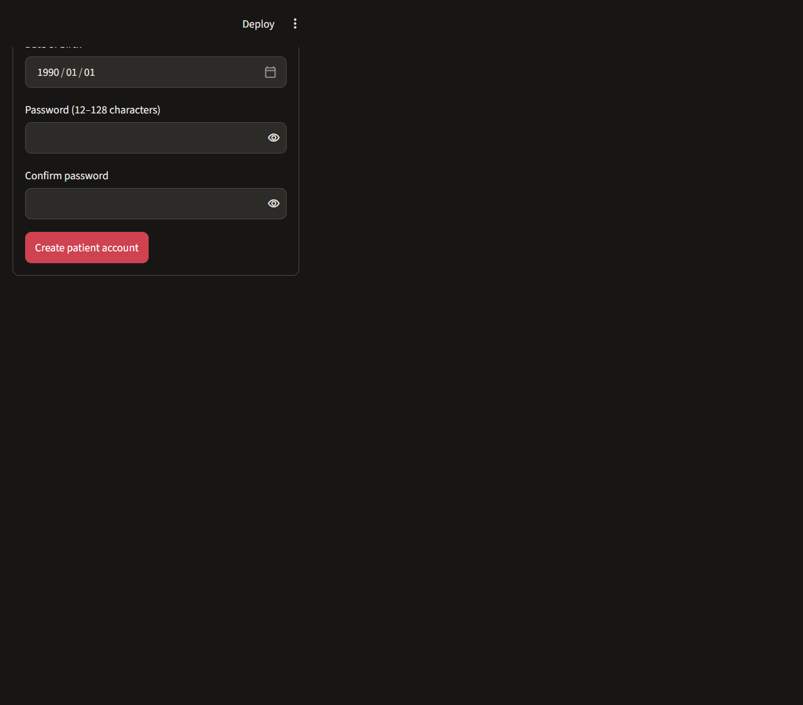

# Application screenshots

These captures show the unauthenticated sign-in and patient sign-up screens.
They contain no patient records, appointment details, or account credentials.
The registration form is split into views because it is taller than the app's
scrollable viewport.

## Sign-in page

## Sign-in form

## Patient sign-up page

## Patient details

## Password and submission

